<!-- banner: generated by scripts/banner.py; add ?v=N to the srcset paths if GitHub serves a cached copy -->
<picture>
  <source media="(prefers-color-scheme: dark)" srcset="assets/banner-dark.svg">
  <source media="(prefers-color-scheme: light)" srcset="assets/banner-light.svg">
  
</picture>

<!-- once the portfolio is live, add:
&nbsp;
-->

## About

I'm a Full-Stack AI Engineer in Hyderabad. I build agentic RAG and multi-agent systems, along with the retrieval pipelines and interfaces around them. Right now I'm working with LangGraph, MCP and Claude.

Each project ships with its own evaluation (gold sets, test suites, latency benchmarks), and every README reports the numbers it actually measured.

## Featured projects

| Project | What it does | Measured |
|---|---|---|
| [**Nimbus**](https://github.com/sujayyy/nimbus-document-intelligence-assistant) | RAG assistant for PDFs: FAISS retrieval, cross-encoder reranking and streaming answers with page-level citations | 0.83 answer accuracy · 6/6 correct refusals on a 24-case gold set |
| [**FinGuard**](https://github.com/sujayyy/FinGuard) | Real-time credit-card fraud detection with 31 engineered features behind a FastAPI scoring service | 0.980 ROC-AUC · 94% recall · p95 9.2 ms |
| [**Medicare Excellence**](https://github.com/sujayyy/Medicare-Excellence) | Hospital coordination platform with patient triage, specialty-aware routing, and patient, doctor and admin roles | 31 tests in CI · 33.6 req/s with 0% failures |
| **PriceOps** *(private)* | LangGraph repricing agent: an LLM analyst recommends a price, code guardrails decide what's allowed, a person approves | 13/13 eval scenarios · 101 tests |

## Evals

<picture>
  <source media="(prefers-color-scheme: dark)" srcset="assets/evals-dark.svg">
  <source media="(prefers-color-scheme: light)" srcset="assets/evals-light.svg">
  
</picture>

## Numbers

<picture>
  <source media="(prefers-color-scheme: dark)" srcset="assets/numbers-dark.svg">
  <source media="(prefers-color-scheme: light)" srcset="assets/numbers-light.svg">
  
</picture>

<!-- refreshed weekly by .github/workflows/cards.yml -->
<picture>
  <source media="(prefers-color-scheme: dark)" srcset="assets/languages-dark.svg">
  <source media="(prefers-color-scheme: light)" srcset="assets/languages-light.svg">
  
</picture>

## Stack

**AI tooling:** LangGraph · LangChain · MCP · Claude · FAISS · XGBoost

## Certifications

- **Databricks**: AI Agent Fundamentals
- **Anthropic**: Introduction to Model Context Protocol
- **LangChain**: Introduction to LangGraph

Banner and cards drawn by <a href="scripts">scripts/</a>: a 1-bit Floyd–Steinberg dither of my photo, and eval numbers copied from each project README.

